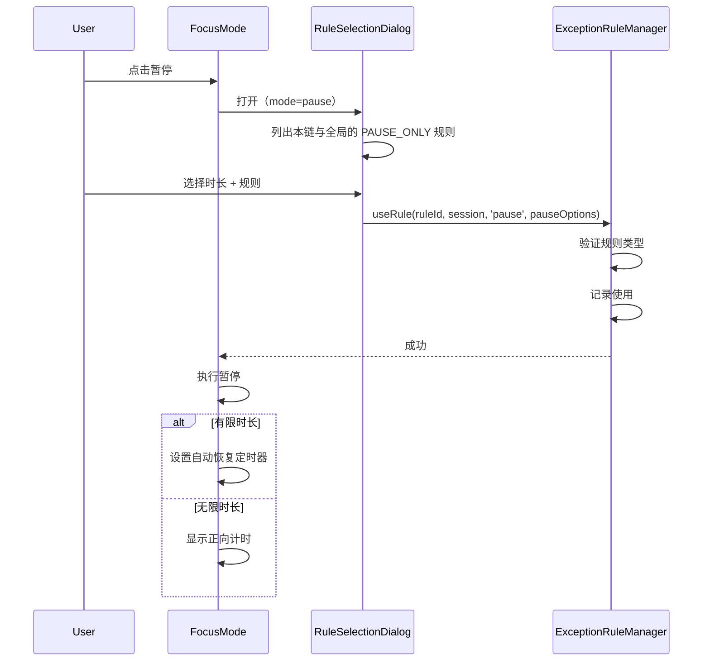
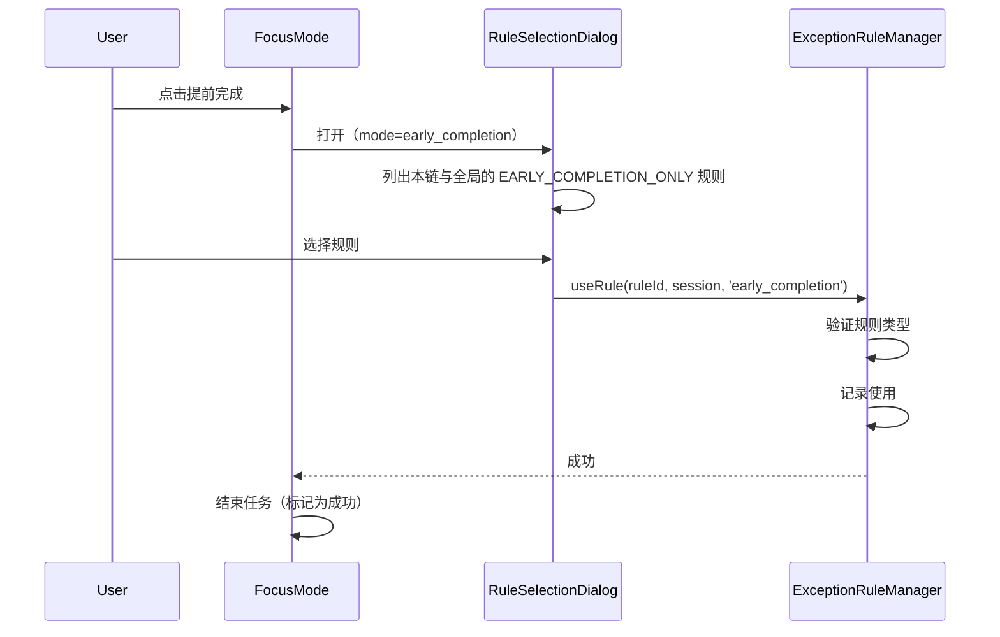

# Exception Rules 领域文档

本文档描述 Momentum 的例外规则系统，包括规则分类、暂停机制、服务架构和常见操作。

---

## 概述

例外规则系统允许用户在专注模式下进行有纪律的暂停或提前完成操作。每次操作必须选择一个规则，系统会记录使用情况用于后续分析。

### 核心理念

- **有纪律的中断**：每次暂停/提前完成都需要明确理由
- **严格分类**：规则只能用于一种操作（暂停 OR 提前完成）
- **使用追踪**：记录每次规则使用，便于复盘

---

## 关键文件

| 文件                                                          | 职责                                              |
| ------------------------------------------------------------- | ------------------------------------------------- |
| `src/types/index.ts`                                          | 核心类型定义（ExceptionRule, RuleUsageRecord 等） |
| `src/hooks/domains/useRulesDomain.ts`                         | 业务逻辑 Hook                                     |
| `src/services/exception-rule-manager/ExceptionRuleManager.ts` | 核心管理器（唯一入口）                            |
| `src/domain/rules.ts`                                         | 校验、重名、动作可用性、使用记录、启动时数据修复  |
| `src/storage/localRuleStore.ts`                               | 本地模式：规则与使用记录的 localStorage 存储      |
| `src/infra/storage/supabase/exceptionRules.ts`                | 云端模式：每用户一行的 `exception_rule_sets`      |
| `src/components/rule-manager/`                                | 规则管理页（首页顶栏“例外规则”按钮打开）          |

---

## 数据模型

### 核心类型

```typescript
// src/types/index.ts

enum ExceptionRuleType {
  PAUSE_ONLY = 'pause_only', // 仅用于暂停
  EARLY_COMPLETION_ONLY = 'early_completion_only', // 仅用于提前完成
}

interface ExceptionRule {
  id: string;
  name: string;
  description?: string;
  type: ExceptionRuleType;
  chainId?: string; // 关联链ID（null = 全局规则）
  scope: 'chain' | 'global';
  createdAt: Date;
  lastUsedAt?: Date;
  usageCount: number;
  isActive: boolean;
  isArchived?: boolean;
}

interface RuleUsageRecord {
  id: string;
  ruleId: string;
  chainId: string;
  sessionId: string;
  usedAt: Date;
  actionType: 'pause' | 'early_completion';
  taskElapsedTime: number; // 使用时任务已进行时间（秒）
  taskRemainingTime?: number; // 剩余时间
  pauseDuration?: number; // 暂停时长（秒）
  autoResume?: boolean; // 是否自动恢复
  ruleScope: 'chain' | 'global';
}

interface PauseOptions {
  duration?: number; // 暂停时长（秒），undefined = 无限
  autoResume?: boolean;
}
```

### 增强错误类型

```typescript
enum ExceptionRuleError {
  // 用户操作错误
  RULE_NOT_FOUND = 'RULE_NOT_FOUND',
  DUPLICATE_RULE_NAME = 'DUPLICATE_RULE_NAME',
  INVALID_RULE_TYPE = 'INVALID_RULE_TYPE',
  RULE_TYPE_MISMATCH = 'RULE_TYPE_MISMATCH',
  VALIDATION_ERROR = 'VALIDATION_ERROR',

  // 系统错误
  STORAGE_ERROR = 'STORAGE_ERROR',
  OPERATION_TIMEOUT = 'OPERATION_TIMEOUT',
  CONCURRENT_MODIFICATION = 'CONCURRENT_MODIFICATION',

  // 数据错误
  DATA_INTEGRITY_ERROR = 'DATA_INTEGRITY_ERROR',
  TEMPORARY_ID_CONFLICT = 'TEMPORARY_ID_CONFLICT',
  RULE_STATE_INCONSISTENT = 'RULE_STATE_INCONSISTENT',
  RECOVERY_FAILED = 'RECOVERY_FAILED',

  // 网络错误
  NETWORK_ERROR = 'NETWORK_ERROR',
  PERMISSION_DENIED = 'PERMISSION_DENIED',
}
```

---

## 服务架构

```text
ExceptionRuleManager（串行执行每个操作）
├── domain/rules.ts（纯函数）
│   └── 校验、重名与相似名称、动作可用性、使用记录、数据修复
└── RuleStore（storage/ports.ts，随当前存储模式切换）
    ├── localRuleStore：localStorage，读写失败直接抛出
    └── 云端 RuleStore：exception_rule_sets，按 revision 拒绝过期写入
```

云端模式下，每台设备第一次读取时会把该设备之前只存在本地的规则合并上传一次
（同 id，或同名、同类型、同作用域视为同一条规则），之后云端删除不会被本地副本恢复。
数据库尚未应用迁移时，规则继续保存在本地。另一台设备已修改规则时保存会失败，
重新打开规则列表即可读取最新数据。

详见 [系统设计文档](../modules/EXCEPTION_RULE_SYSTEM.md)。

---

## 暂停功能

### 暂停时长选项

| 选项     | 时长    | 自动恢复 |
| -------- | ------- | :------: |
| 短暂休息 | 15 分钟 |    ✓     |
| 中等休息 | 30 分钟 |    ✓     |
| 长休息   | 60 分钟 |    ✓     |
| 无限暂停 | -       |    ✗     |

### 暂停流程



### 提前完成流程



---

## API 参考

### ExceptionRuleManager 方法

| 方法                                                             | 说明                                 |
| ---------------------------------------------------------------- | ------------------------------------ |
| `initialize()`                                                   | 修复存量数据；首次操作前自动调用     |
| `getAllRules()`                                                  | 获取所有规则（含已删除）             |
| `createRule(name, type, description?, { reuseExisting })`        | 创建全局规则；同名时抛错或复用       |
| `createChainRule(chainId, name, type, description?)`             | 创建链专属规则；名称在同一条链内唯一 |
| `updateRule(id, { name, type, description })`                    | 更新规则；相似名称附带警告           |
| `deleteRule(id)`                                                 | 停用规则，保留使用记录               |
| `useRule(ruleId, session, action, pauseOptions?)`                | 校验可用性并记录一次使用             |
| `suggestRuleNames(name)`                                         | 给出三个未被占用的带序号名称         |
| `exportRules(includeUsageData?)` / `importRules(rules, options)` | 导出激活规则 / 一次保存地导入        |

---

## 错误处理

### EnhancedExceptionRuleException

```typescript
class EnhancedExceptionRuleException extends ExceptionRuleException {
  type: ExceptionRuleError;
  message: string;
  userMessage: string; // 用户友好消息
  severity: 'low' | 'medium' | 'high' | 'critical';
  recoverable: boolean;
  suggestedActions: string[];
  context: any;

  // 快捷创建方法
  static createUserFriendly(type, userMessage, technicalMessage, context);
  static createCritical(type, message, context);
  static createRecoverable(type, message, suggestedActions, context);

  // 分类
  getCategory(): 'user_error' | 'system_error' | 'data_error' | 'network_error';
}
```

### 错误分类处理

| 类别     | 错误类型                                      | 处理策略           |
| -------- | --------------------------------------------- | ------------------ |
| 用户错误 | VALIDATION_ERROR, DUPLICATE_RULE_NAME         | 显示提示，引导修正 |
| 系统错误 | STORAGE_ERROR, OPERATION_TIMEOUT              | 重试，降级处理     |
| 数据错误 | DATA_INTEGRITY_ERROR, RULE_STATE_INCONSISTENT | 显示错误           |
| 网络错误 | NETWORK_ERROR                                 | 重试，离线模式     |

---

## 数据完整性

`ExceptionRuleManager.initialize()` 在启动时调用一次
`exceptionRuleStorage.repairStoredData()`，由纯函数 `repairRuleData` 修复旧版本
或外部损坏留下的数据，有改动才写回：

| 问题                       | 处理                              |
| -------------------------- | --------------------------------- |
| 规则缺少 ID 或 ID 为空     | 生成新 ID                         |
| 规则 ID 含空格             | 生成新 ID，使用记录随之改指向     |
| 多条规则 ID 相同           | 靠后的规则生成新 ID               |
| type 缺失或非法            | 改为 `pause_only`                 |
| createdAt 无法解析         | 改为当前时间                      |
| usageCount 非数字或为负    | 改为 0                            |
| 激活规则重名（忽略大小写） | 靠后的规则追加序号，如 `午休 (2)` |
| 使用记录指向不存在的规则   | 删除该记录                        |
| 使用记录的 usedAt 无法解析 | 改为当前时间                      |

缺少名称的规则没有安全的默认值，保持原样。`usageCount` 不再按使用记录条数重算。

---

## 缓存策略

名称重复检查直接读取当前存储；规则选择列表重新加载时按链、操作类型及激活状态筛选。
第二轮删除的预验证缓存及第三轮删除的状态镜像均不参与实际规则使用。
使用规则时 `assertRuleUsableForAction` 检查规则是否存在、已激活且类型与动作匹配。
规则选择对话框列出当前链的链专属规则和所有全局规则。

缓存的所有权、失效与清理见 [缓存指南](../guides/CACHING_STRATEGY.md)。

---

## 常见操作场景

### 场景：创建暂停规则

```typescript
const result = await exceptionRuleManager.createRule(
  '接电话',
  ExceptionRuleType.PAUSE_ONLY,
  '有重要电话需要接听',
);

if (result.warnings.length > 0) {
  // 可能有名称相似的规则
}
```

### 场景：应用规则暂停任务

```typescript
const context: SessionContext = {
  sessionId: activeSession.id,
  chainId: chain.id,
  chainName: chain.name,
  startedAt: activeSession.startedAt,
  elapsedTime: calculateElapsedTime(),
  remainingTime: calculateRemainingTime(),
  isDurationless: chain.isDurationless ?? false,
};

const pauseOptions: PauseOptions = {
  duration: 15 * 60, // 15 分钟
  autoResume: true,
};

await exceptionRuleManager.useRule(
  selectedRule.id,
  context,
  'pause',
  pauseOptions,
);
```

### 场景：处理重复规则名称

```typescript
// 同名时复用已有规则（专注模式的做法）
const { rule } = await exceptionRuleManager.createRule(
  '午休',
  ExceptionRuleType.PAUSE_ONLY,
  undefined,
  { reuseExisting: true },
);

// 或者在重名错误后给出可用名称（规则管理页的做法）
const names = await exceptionRuleManager.suggestRuleNames('午休'); // ['午休 2', ...]
```

---

## 初始化流程

管理器在首次操作前调用一次 `repairRuleData`，有改动才写回；修复失败时下次操作会重试。

---

## 迁移与兼容

### 从旧版迁移

系统自动处理以下迁移：

1. 旧版规则类型自动映射到新枚举
2. 缺少 scope 字段的规则自动设置为 'global'
3. 缺少 usageCount 的规则自动初始化为 0

### 向后兼容

- 旧版 API 签名保持兼容
- 新字段（如 pauseDuration, autoResume）为可选
- 存储格式保持 JSON 兼容

---

## 相关文档

- `docs/guides/ARCHITECTURE.md` - 整体架构
- `docs/features/DOMAIN_BETTING.md` - 赌注系统
- `DEBUGGING_GUIDE.md` - 调试指南
